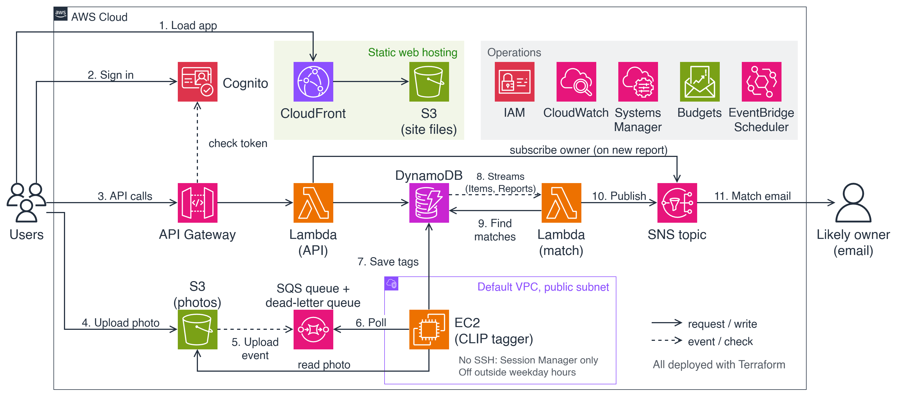

# Mofongo

A lost-and-found web app on AWS. A finder posts a photo of a found item, an open-source image model tags it, the app compares it with open lost reports, and the likely owner gets an email.

All AWS infrastructure is defined in Terraform. The plan and the reasons behind the design are in [docs/plan.md](docs/plan.md).

The diagrams are edited in draw.io: [docs/diagrams/mofongo-architecture.drawio](docs/diagrams/mofongo-architecture.drawio) has the architecture and workflow pages. `docs/diagrams/archive/` keeps the earlier console-based design.

## Layout

| Folder | Holds |
|---|---|
| `infra/bootstrap/` | The S3 bucket that stores Terraform state. Applied once. |
| `infra/envs/dev/` | The real stack. Everything else is added here. |
| `infra/modules/` | Reusable Terraform modules, added as the stack grows. |
| `api/` | `openapi.yaml` (the endpoint list) and `schemas/` (one JSON Schema per request body). |
| `backend/` | Lambda code: the API and the matcher. |
| `worker/` | The EC2 photo tagger (CLIP). |
| `web/` | The frontend. |
| `docs/` | The plan, the data model, decision records and diagrams. |

## Working on the infrastructure

See [infra/README.md](infra/README.md) for the one-time setup and the daily loop.
